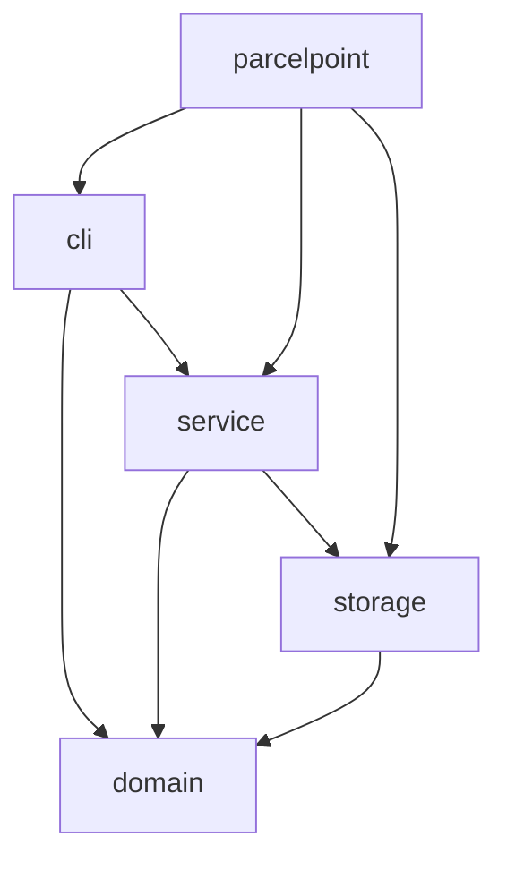
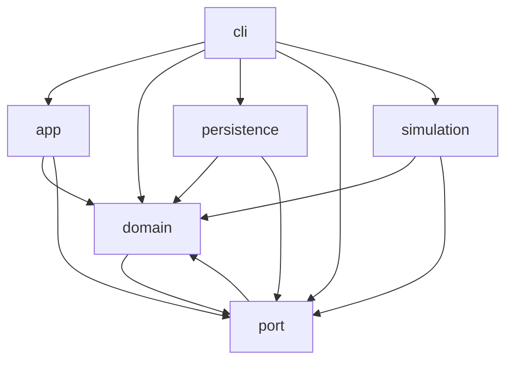
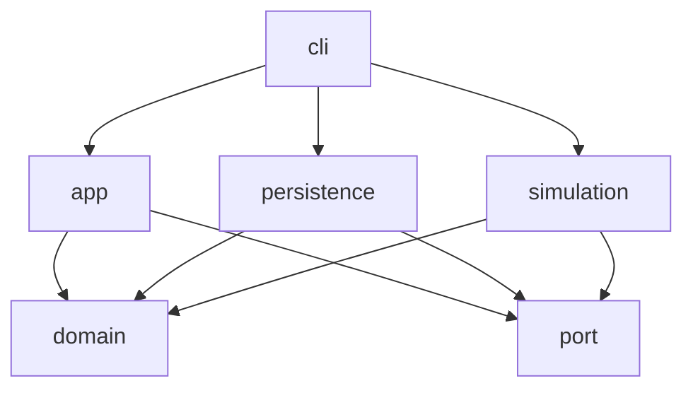

# ITCS382 Lab: Intended and Implemented Architecture — Quiz Answers

All commands were run on 15 November 2026 with JDK 25 (`jdeps` 25.0.5) and Maven 3.10.0.
Each section below is one MyCourses quiz question and can be pasted into its essay box.

---

## Quiz Question 1 — Part A

**jdeps output (Step A2)**

```
classes -> target\classes
   parcelpoint          -> parcelpoint.cli
   parcelpoint          -> parcelpoint.service
   parcelpoint          -> parcelpoint.storage
   parcelpoint.cli      -> parcelpoint.domain
   parcelpoint.cli      -> parcelpoint.service
   parcelpoint.domain   -> parcelpoint.domain
   parcelpoint.service  -> parcelpoint.domain
   parcelpoint.service  -> parcelpoint.storage
   parcelpoint.storage  -> parcelpoint.domain
   parcelpoint.storage  -> parcelpoint.storage
```

**1. Why jdeps reads `target/classes`, and what it prints before `mvn package`.**
jdeps analyses bytecode, not source code. In a `.class` file the compiler has already resolved every type
that a class uses into a fully qualified name such as `parcelpoint.service.ParcelService`, so jdeps can read
the real dependencies directly. In a `.java` file the same information is incomplete: classes in the same
package need no import, imports can use wildcards (`import parcelpoint.domain.*`), and names can be written
fully qualified inside the code without any import. Only compiling resolves all of these, so `mvn package`
must run first to produce `target/classes`. If I run jdeps before `mvn package` (I tested this after
`mvn clean`), it prints only `Warning: Path does not exist: target/classes` and no dependency lines. It
still exits with code 0, so an empty result does not mean "no dependencies", it means "nothing was checked".

**2. Why `domain -> domain` and `storage -> storage` do not count.**
These lines say that a class uses another class in the *same* package. For example, `Parcel` uses
`ParcelSize` and `ParcelStatus`, and `H2ParcelRepository` implements `ParcelRepository`. That is
collaboration inside one package (its cohesion), not coupling between two packages. The package diagram
only draws arrows between different packages, so a self-line can neither match nor break any arrow of the
design. (`cli` and `service` have no self-line simply because each holds only one class.)

**Mermaid flowchart (Step A4)**



**3. Does the implemented architecture match the intended architecture?**
Yes, it matches exactly. I compared in both directions. From code to diagram, each of the 8 jdeps arrows
(`parcelpoint→cli`, `parcelpoint→service`, `parcelpoint→storage`, `cli→domain`, `cli→service`,
`service→domain`, `service→storage`, `storage→domain`) appears in the package diagram. From diagram to
code, the diagram has the same 8 arrows and every one appears in the jdeps output. There is no extra arrow,
no missing arrow, and no cycle: every arrow points downward towards `domain`, and `domain` depends on
nothing.

**4. Why `Main → storage` is allowed but `cli → storage` is forbidden.**
`Main` is the composition root. It is not part of any layer; its only job is to start the program and wire
the layers together. Something has to choose the concrete `H2ParcelRepository` and pass it into
`ParcelService` as a `ParcelRepository` (dependency injection), and doing it in `Main` keeps that choice in
one line in one place. Main has no business or UI logic, so this dependency does not leak storage details
anywhere else. `cli` is the presentation layer. In the layered style each layer talks only to the layer
directly below it, so `cli` must go through `service`. If `cli` used `storage` directly it would skip the
service layer, bypass its rules (locker allocation, fees), and couple the user interface to the database
technology, so any change of storage would ripple into the UI.

---

## Quiz Question 2 — Part B

**5. Prediction before running.**
`parcelpoint.cli -> parcelpoint.storage`. After `mvn package` and jdeps, this was exactly the one new line
(the build still succeeded).

**6. Which layered-style rule is broken, and what happens with a file store.**
It breaks the rule that a layer may only use the layer directly below it (closed layers, no layer
skipping): `cli → service → storage` became `cli → storage` directly. `ParcelCommandLine` now hard-codes
the concrete class `H2ParcelRepository` and the path `"./data/parcelpoint"`. If the team moved from H2 to a
file store, changing `Main` would no longer be enough. `ParcelCommandLine` would also have to be edited,
recompiled and retested even though nothing in the user interface changed. If someone forgot it, the
`staff` command would still read the old H2 database while `store` and `pickup` used the new file store, so
the staff list would show stale or wrong data (or fail if the H2 file was removed).

**7. Why the class view helps more than the package view.**
The package view only says that *some* class in `cli` uses *some* class in `storage`. The class view names
both ends: `parcelpoint.cli.ParcelCommandLine -> parcelpoint.storage.H2ParcelRepository`. That tells me
exactly which file to open and which type reference to remove. It also separates the allowed uses
(`Main → H2ParcelRepository`, `Main → ParcelRepository`, `ParcelService → ParcelRepository`) from the
forbidden one, and it shows that the drift uses the concrete class, not the interface. In a real project
with many classes per package, this saves a manual search through every file.

**8. Why the `domain ↔ storage` cycle makes both packages harder to change, test and reuse.**
The cycle creates tight, two-way **coupling**: `domain` depends on `storage` and `storage` depends on
`domain`, so the two packages can no longer be understood or used separately and in effect become one unit.
In terms of **connascence**, `Parcel` now has connascence of name and type with `ParcelRepository` (it
knows its name and the signature of `save`), and `ParcelRepository` already had it with `Parcel`. This
strong connascence now crosses the package boundary in both directions, while the guideline is to keep
strong connascence inside a module and weak connascence between modules.
- *Change:* a change to `ParcelRepository.save` can force a change in `Parcel`, and a change in `Parcel`
  can force a change in the repository, so ripples go both ways.
- *Test:* to unit-test a simple rule such as `Parcel.fee` I must now compile against, and possibly stub,
  the storage package.
- *Reuse:* I cannot take `domain` into another program (for example a web version) without also taking
  `storage`.

It also lowers the **cohesion** of `Parcel`, which now mixes business rules with persistence.

**9. Why the compiler accepted both changes, and why a separate check is needed.**
The compiler only checks that the code is valid Java: every type exists on the classpath, is accessible,
and is used with the right signature. `H2ParcelRepository` and `ParcelRepository` are `public` classes on
the same classpath, so any class in any package is allowed to use them. Java has no concept of "layers".
The package diagram lives in a design document that the compiler never reads, and Java's visibility
modifiers (`public` / package-private) cannot say "public, but only to `service` and `Main`". The program
also still ran correctly, so tests would not fail either. A team therefore needs a separate, automated
architecture check (a fitness function) such as jdeps, run on every build or in CI. It compares the real
dependencies against the allowed arrows and catches one-line shortcuts as soon as they appear, before they
pile up. This kind of change is easy to miss in code review.

---

## Quiz Question 3 — Part C

**Team:** qwerty — repository `ICT-Mahidol/2026-ITCS382-Sec1-Gemini8`, branch `main`, commit `873c772`
(latest at the time of the check). Root package: `ocs`. `mvn package` gives BUILD SUCCESS with 53 tests, 0
failures. The code implements all four selected use cases (UC01, UC07, UC09, UC04). The evidence section of
`qwerty_D4_Report.md` still says "To be added", but the code under `ocs/` is complete enough to check.

**10. jdeps output and Mermaid flowchart**

```
> jdeps -verbose:package -filter:none -e "ocs.*" target/classes
classes -> target\classes
   ocs.app          -> ocs.app
   ocs.app          -> ocs.domain
   ocs.app          -> ocs.port
   ocs.cli          -> ocs.app
   ocs.cli          -> ocs.cli
   ocs.cli          -> ocs.domain
   ocs.cli          -> ocs.persistence
   ocs.cli          -> ocs.port
   ocs.cli          -> ocs.simulation
   ocs.domain       -> ocs.domain
   ocs.domain       -> ocs.port
   ocs.persistence  -> ocs.domain
   ocs.persistence  -> ocs.persistence
   ocs.persistence  -> ocs.port
   ocs.port         -> ocs.domain
   ocs.simulation   -> ocs.domain
   ocs.simulation   -> ocs.port
```

After I skip the first line and the 4 self-lines, 13 arrows remain. No class sits directly in the root
package `ocs` (`OcsMain` is in `ocs.cli`), so every node drops the `ocs.` prefix.

Implemented architecture (from jdeps):



For comparison, these are the internal arrows of the intended architecture as I read them from the package
diagram in `qwerty_D4_Design.md` (`img/qwerty_D4_PackageDiagram.svg`). The arrows to the external JDBC,
H2 and Local Storage packages are left out because `-e "ocs.*"` hides them.



**11. Differences and cycles**

Code to diagram: 9 of the 13 jdeps arrows appear in the diagram and 4 do not. Diagram to code: all 9
diagram arrows appear in jdeps. There is 1 cycle. I found each causing class with the class view of Step
B2 (`jdeps -verbose:class -filter:none -e "ocs.port.*"` and `-e "ocs.domain.*"`).

| What you found | Where | What you would fix |
|---|---|---|
| An arrow in the code that the diagram does not show | `cli → domain`. Classes: `ScienceProgramCommandLine → SciencePlan, ObservingProgram, TargetCoordinates, InstrumentSettings, EvaluationResult`; `StatusEnquiryCommandLine → StatusReport, Telemetry, QualityReport`; `CommandSequenceCommandLine → ObservingSequence, SequenceState`; `ObservingQueueCommandLine → QueueRecommendation`; and `OcsMain → Scheduler, ResourceAllocator, ProgramValidator, HealthMonitor, MotionCoordinator, ...` | **The design.** The dependency is really needed: the services return domain objects that the CLI must display, the team's own class diagram already has `ScienceProgramCommandLine → SciencePlan`, and `OcsMain` is the composition root that must construct the domain services. Add the arrow `cli → domain` (ParcelPoint has the same `cli → domain` arrow). |
| An arrow in the code that the diagram does not show | `cli → port`. Class: only `ocs.cli.OcsMain` → all nine port interfaces (`ProgramRepository`, `QueueRepository`, `SequenceRepository`, `EventLog`, `SimulatorPort`, `ObservatoryContextPort`, `TelescopePort`, `EnclosurePort`, `InstrumentPort`) | **The design.** `OcsMain` is the composition root. It wires adapters to services through the port types, which is exactly what the report's Ports and Adapters section describes. It is the same allowed case as ParcelPoint's `Main → storage.ParcelRepository`. None of the four `*CommandLine` classes use a port, so it is not a shortcut. Add `cli → port` to the diagram (and note that only `OcsMain` may use it). |
| An arrow in the code that the diagram does not show | `port → domain`. Classes: every port interface uses domain value types in its signatures, e.g. `TelescopePort → TargetCoordinates, Telemetry`; `InstrumentPort → InstrumentSettings, RawData, Telemetry`; `ProgramRepository → SciencePlan, ObservingProgram`; `SequenceRepository → ObservingSequence, QualityReport, RawData` | **The design.** A port has to describe its operations in the domain's own types. That is the correct direction in Ports and Adapters, and the only alternative would be passing primitives, which would raise connascence of position. Add `port → domain` to the diagram. |
| An arrow in the code that the diagram does not show | `domain → port`. Classes: `HealthMonitor → TelescopePort, EnclosurePort, InstrumentPort`; `MotionCoordinator → TelescopePort, EnclosurePort`; `SubsystemTelemetryMonitor → TelescopePort, EnclosurePort, InstrumentPort` | **The code.** This arrow closes the cycle below, and it goes against the report's own rule that "Domain types do not import application or adapter packages". These three classes coordinate devices for a use case, which is application work, not a domain rule. |
| An arrow in the diagram that the code does not have | None. All 9 internal arrows of the diagram (`cli→app`, `cli→persistence`, `cli→simulation`, `app→domain`, `app→port`, `persistence→domain`, `persistence→port`, `simulation→domain`, `simulation→port`) are in the jdeps output. | No fix needed. (Outside the `ocs.*` filter, a separate jdeps run confirms `persistence → java.sql`. There is no compile-time `persistence → org.h2` dependency because the H2 driver is loaded at runtime from the JDBC URL. The `<<use>>` arrow to H2 is still correct as a runtime dependency.) |
| A cycle between packages | `domain ↔ port`: `domain → port` (the three classes above) and `port → domain` (port signatures use domain types) | **The code.** Break it by removing `domain → port`: move `HealthMonitor`, `MotionCoordinator` and `SubsystemTelemetryMonitor` from `ocs.domain` to `ocs.app`, next to the services that use them (`SequenceService`, `StatusService`). No other domain class refers to them. I checked this on a scratch copy of the repo: after the move `mvn package` passed all tests, and jdeps no longer printed `ocs.domain -> ocs.port`, so `domain` depends on nothing and the cycle is gone. The arrows that remain (`app → port`, `app → domain`, `port → domain`) are all in the corrected diagram. |

After these fixes the corrected package diagram would add `cli → domain`, `cli → port` and `port → domain`,
and the code would drop `domain → port`. Code and design would then match with 12 arrows and no cycle.

---

## Quiz Question 4 — AI usage declaration

| Tool | Exact model | Date | What I used it for | How I checked it |
|---|---|---|---|---|
| Cursor (Agent mode) | Claude Opus 5.5 (Anthropic) | 15 November 2026 | Running the lab steps (mvn package, jdeps package and class views) for Parts A–C; drafting the explanations for questions 1–11; reading the team package diagram; testing the cycle fix on a scratch copy | I re-ran every jdeps command myself and compared each line with the outputs pasted above and with the outputs printed in the lab sheet (Steps A2, B1, B2, B3, B4). I checked the "before mvn package" answer by running jdeps after `mvn clean`. I traced every arrow of `qwerty_D4_PackageDiagram.svg` by hand against the 13 jdeps arrows in both directions. I checked each causing class from the class view by opening the Java file and finding the import (e.g. `import ocs.port.TelescopePort;` in `MotionCoordinator.java`). I checked the cycle fix by building and testing it. I checked the explanations against the lecture terms (layered style, coupling, cohesion, connascence). |
